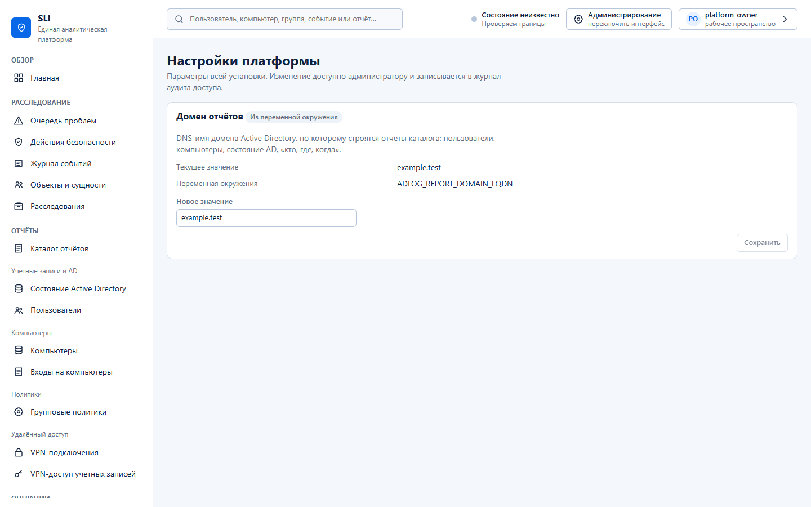

# Руководство администратора SLI Platform

Документ для тех, кто устанавливает и обслуживает платформу. Он объясняет, из
чего она состоит и что нужно делать регулярно, и отсылает к подробным
регламентам, не повторяя их. Работа с интерфейсом описана в
[USER_GUIDE.md](USER_GUIDE.md).

Все примеры используют вымышленные значения: домен `example.test`, адреса из
диапазонов RFC 5737 (например `192.0.2.10`), угловые скобки `<...>` — то, что
вы подставляете сами. Пароли, строки подключения и ключи никогда не записывайте
в репозиторий, журналы и заявки.

## 1. Из чего состоит платформа

Текущий серверный путь — Linux/Docker Compose: PostgreSQL 18, ClickHouse,
HTTPS API и отдельные фоновые сервисы из
[`deploy/linux/docker-compose.yml`](../deploy/linux/docker-compose.yml).
Серверный Compose не включает Windows acquisition; установка и допуск агента —
отдельная процедура. Наличие контейнера или heartbeat само по себе не доказывает
успешный сбор и восстановимость данных.

Windows supervisor, интерактивная сессия и DPAPI относятся к сохранённому legacy
контуру, а не к установке Linux-сервера. Реестр
[`runtime_component_registry.py`](../server/sli/ops/runtime_component_registry.py)
помечает `storage_v2_outbox` и старый `ad_context_snapshot` как отключённые и
не supervised. Импорт пишет напрямую в V2; запуск retired outbox не требуется.

## 2. Установка

Для первой нативной беты на чистом Debian 13 используйте
[быструю установку](../README.ru.md#быстрая-установка--первая-бета-debian-13):
пакеты, `sudo sli-setup`, каталог на существующем диске, HTTPS 443 и одноразовое
создание владельца в браузере. Следующий маршрут относится к Compose.

1. Начните с [руководства установки сервера](install/SERVER_INSTALL.ru.md).
   Оно отдельно описывает подписанный офлайн-комплект и изолированную оценку;
   unsigned evaluation не является доверенным обновлением существующей установки.
2. Следуйте выбранной процедуре для внешнего trust store, TLS, секретов,
   PostgreSQL/ClickHouse и томов. Не переносите Windows/DPAPI bootstrap на Linux.
3. Для сбора используйте [руководство установки агента](install/AGENT_INSTALL.ru.md)
   и явные допуски соответствующего источника. Запуск сервера не разрешает сбор
   и не даёт прав записи на обследуемых системах.
4. Проверьте состояние сервисов и HTTPS/readiness.
   Приёмка установки, источников и восстановления требует отдельных результатов;
   исходный код и unit-тесты её не заменяют.

Оставшиеся примеры PowerShell в этом руководстве относятся только к явно
выбранному legacy checkout, а не к Linux lifecycle.

## 3. Учётные записи, роли и права

Учётные данные хранятся в PostgreSQL: пароль — только как хэш Argon2id, сессия
и API-ключ — только как SHA-256-хэш.

Для новой Linux-установки используйте bootstrap учётной записи из руководства
установки. Для legacy Windows checkout доступна ручная команда
(пароль вводится интерактивно):

```powershell
.\.venv\Scripts\python.exe scripts\auth\manage_auth.py create-user --username <локальный-администратор> --role admin
```

Грубые роли: `viewer` (в интерфейсе подписана «ИБ») — просмотр; `operator`
(«ИТ») — ручной сбор, анализ и обновление находок; `admin` («Администратор») —
полный доступ. Поверх ролей работает тонкая модель доступа
(`server/sli/access`): пакеты, группы, прямые и временные назначения
складываются, явный запрет всегда сильнее. Меню интерфейса строится по
эффективным правам, но это лишь удобство: сервер проверяет права на каждый
запрос.

Зона администрирования («Операции» и «Администрирование») открывается значком шестерёнки в верхней панели; на её страницах левое меню заменяется административным со ссылкой «← К работе», адреса страниц не меняются. Пункты показываются по возможностям пользователя:

- «Доступ» — `/app/access`: доступы пользователей (нужна возможность
  `access.manage`);
- «Заявки на доступ» — `/app/access-requests`: заявки на отдельные
  опубликованные отчёты;
- «Студия отчётов» — `/app/report-studio` (видна при `reports.design`,
  `reports.publish` или `reports.assign`; прежние адреса `/app/report-management`,
  `/app/report-editor` и `/app/report-builder` перенаправляют на неё; описание
  ниже);
- «Настройки платформы» — `/app/platform-settings`.

### Студия отчётов

Одна страница для всего жизненного цикла отчётов конструктора. Слева — реестр
(название, ключ, статус, версия, видимость, число назначений и пакетов,
источник «код» или «конструктор»; фильтр по статусу, кнопка «Создать отчёт»),
справа — карточка выбранного отчёта с вкладками:

- «Определение» — набор данных (только те, которые сервер умеет выполнять),
  поля, любое число фильтров и сортировок (только по выполняемым ключам),
  действия, владелец, чувствительность, назначение. Кнопка «Проверить
  определение» показывает ответ сервера человеческими словами и список
  возможностей, нужных для чтения отчёта, с отметкой «есть у вас / нет у вас»;
- «Предпросмотр» — до 20 строк образца либо объяснение, почему их нет (не хватает
  возможностей, строк нет, сервер не раскрывает образец);
- «Публикация» — «Сохранить черновик», «Опубликовать» (через диалог),
  «Выпустить черновик» для старой версии, «Снять с публикации», список версий и
  переключатели «В каталоге» и «Можно запросить». Все эти действия требуют обеих
  возможностей: `reports.design` и `reports.publish`; без первой сервер отвечает
  `report_design_capability_required`. Новые отчёты по умолчанию приватные: не
  видны в каталоге и недоступны для заявок, пока видимость не включена явно.
  Если новая версия расширяет данные отчёта, у которого уже есть назначения,
  сервер отвечает `report_security_reapproval_required`: сохраните изменения
  как новый отчёт с другим ключом и назначьте доступ заново;
- «Доступ» — кто имеет отчёт, пакеты, число заявок на рассмотрении, кнопки
  «Назначить доступ» (нужна `reports.assign`), «Назначить мне» и ссылка «Открыть
  отчёт».

Отчёты, определённые в коде, показываются только для чтения (сведения и доступ).
Пользователю только с `reports.assign` доступен каталог и вкладка «Доступ».
Счётчик «Без назначений» считает опубликованные отчёты без прямых назначений и
без пакетов.

Страница «Пользователи и доступ» (`/app/admin`, не вынесена в меню) —
управление учётными записями: сброс пароля (все сессии записи отзываются) и
выпуск API-ключа; открытый ключ показывается один раз.

Интеграционный ключ можно создать и из командной строки
(`manage_auth.py create-api-key`, отзыв — `revoke-api-key --id <id>`). Ключ
передаётся заголовком `Authorization: Bearer ...` или `X-ADLog-API-Key`.

Включение обязательной авторизации (`ADLOG_AUTH_REQUIRED=1`) требует HTTPS:
пути к сертификату и ключу задаются `ADLOG_TLS_CERT_PATH` и `ADLOG_TLS_KEY_PATH`.
Вход по обычному HTTP при включённой авторизации отклоняется. После восьми
неверных паролей с одного IP за 15 минут вход с него временно блокируется
(порог настраивается `ADLOG_MAX_LOGIN_FAILURES`, `ADLOG_LOGIN_FAILURE_WINDOW_SECONDS`).
Сессия живёт 12 часов, с «Запомнить меня» — до 14 дней.

## 4. Настройки платформы

Страница `/app/platform-settings` («Настройки платформы», раздел
«Администрирование») показывает параметры всей установки. Изменять их может
только администратор с возможностью `access.manage`; каждое изменение пишется в
журнал аудита доступа.

Сейчас доступна одна настройка — **«Домен отчётов»** (`reports.domain_fqdn`):
DNS-имя домена Active Directory, по которому строятся отчёты каталога
(пользователи, компьютеры, состояние AD, «кто, где, когда»), например
`example.invalid`. Единственный источник значения в рантайме — таблица
`platform_settings`. Установщик Linux однократно записывает `SLI_INSTALL_DOMAIN`
в эту настройку при создании новой БД; последующие запуски и переменные окружения
не переопределяют сохранённое значение. Администратор меняет его на этой странице.

Встроенного значения по умолчанию нет. Без настройки домен помечен «Не задано»:
отчёты каталога отвечают «Данные недоступны» (HTTP 503, код
`report_domain_not_configured`), воркеры снимков и проекции пропускают цикл,
шаг «Домен отчётов» на странице «Первичная настройка» остаётся невыполненным.
Если БД недоступна, домен из окружения также не используется.

Принимается только корректное DNS-имя. Значение из базы кэшируется на короткое
время, поэтому отчёты подхватывают новое значение примерно в течение минуты.
Страница показывает, откуда взято текущее значение, кто и когда его менял.
Таблица настроек создаётся миграцией 146.



### Первичная настройка

Страница `/app/setup` («Первичная настройка», раздел «Администрирование»,
возможность `access.manage`) — список шагов запуска платформы с текущим
состоянием из системы (`GET /api/v1/setup/status`). Страница не запускает
сбор; на ней можно изменить только список доменов AD и список контроллеров
домена. Шаги:

1. **Домен отчётов** — значение и ссылка на «Настройки платформы».
2. **Домены Active Directory** — таблица доменов из базы (DNS-имя,
   NetBIOS-имя, лес, число серверов) и форма «Добавить домен»: DNS-имя
   (например `corp.example.com`) и необязательное NetBIOS-имя (до 15 символов:
   латинские буквы, цифры, дефис). Лес по умолчанию совпадает с доменом.
   Домен с тем же DNS-именем или NetBIOS-именем второй раз не добавляется
   (ошибка 409). Домен записывается в таблицу `domains` и в журнал аудита
   доступа (`setup_domain_add`); добавление доступно роли администратора с
   возможностью `access.manage` (`POST /api/v1/setup/domains`, список —
   `GET /api/v1/setup/domains`; NetBIOS-имя существующего домена меняет
   `POST /api/v1/setup/domains/{fqdn}`). Удалять домены нельзя: на них
   ссылаются события, серверы и снимки отчётов. Домен также появляется при
   первой загрузке данных каталога. Отчёты строятся по одному домену — тому,
   что задан в «Настройках платформы» (`reports.domain_fqdn`); добавление
   второго домена на отчёты не влияет. Отдельная миграция не нужна: рабочая
   роль `adlog_user` владеет таблицами `domains` и `forests`.
3. **Контроллеры домена** — цели сбора. Таблица показывает контроллер, домен,
   источник (`база` или `файл`), признак проверки DNS и состояние. Форма
   «Добавить контроллер» (администратору с `access.manage`): полное DNS-имя
   контроллера (FQDN, IP-адрес не принимается) и домен из списка добавленных
   доменов; кнопки «Отключить»/«Включить» исключают контроллер из сбора или
   возвращают его. Контроллеры не удаляются. Изменения пишутся в журнал аудита
   доступа (`setup_dc_add`, `setup_dc_update`) —
   `GET`/`POST /api/v1/setup/domain-controllers`, `POST
   /api/v1/setup/domain-controllers/{hostname}` с `{"enabled": true|false}`.
   Таблица `domain_controller_targets` создаётся миграцией 147.
   Порядок выбора целей сбора: включённые строки таблицы, если в ней есть
   хотя бы одна строка (если отключены все — целей нет, к файлу возврата нет);
   иначе, на переходный период, файл `config/domain_controllers.json`
   (образец: `config/domain_controllers.example.json`). Первый контроллер,
   добавленный на странице, переносит в базу и контроллеры из файла, чтобы
   они не пропали. Весь файл можно перенести заранее одноразовым скриптом
   (по умолчанию `plan` — только чтение, печатает числа без имён; повторный
   запуск безопасен):

   ```powershell
   .\.venv\Scripts\python.exe scripts\maintenance\import_domain_controllers_from_file.py plan
   .\.venv\Scripts\python.exe scripts\maintenance\import_domain_controllers_from_file.py apply --confirm IMPORT-DOMAIN-CONTROLLERS
   ```

   Домен импортированного контроллера определяется по его FQDN
   (зарегистрированный домен, которому он принадлежит), иначе остаётся пустым.
   Подтверждённый владельцем IP-адрес для проверки DNS (`owner_confirmed_ip`)
   переносится в базу, но на странице и в статусе не показывается — только
   признак «проверка DNS включена».
4. **Источники** — пакеты источников, поставляемые с платформой
   (`config/source_packs`).
5. **Первый сбор** — разрешён ли сбор и когда он последний раз завершился
   успешно. Состояние сбора и его запуск — на странице «Сбор и хранилище».

Каждый шаг помечен «Готово», «Требует действия» или «Нет данных» (раздел не
удалось прочитать, например база недоступна).

## 5. Источники и сбор

Контролируемый набор каналов Windows: Security (приоритетный), Directory
Service, PowerShell/Operational, TaskScheduler/Operational, System, DNS Server.
У каждого канала собственная отметка прогресса в PostgreSQL и свои ограничения
по количеству и времени. Отметка двигается только после успешного импорта;
уменьшение `last_event_record_id` — критическая ошибка. Сбор не меняет AD, GPO,
политики аудита и настройки контроллеров.

В сохранённом Windows-контуре сбором владеет внешний `collection_worker.py` под
supervisor. Для Linux агентный путь и его допуски описаны в руководстве агента;
серверный Compose сам Windows acquisition не запускает.
Переключатель `ADLOG_ENABLE_INPROCESS_COLLECTION_SCHEDULER=1` — только для
отката и диагностики, в обычной работе не используется.

Новые источники подключаются пакетами источников. Состояние каждого источника
видно на странице «Сбор и хранилище» (раздел 8).

## 6. Storage V2 и хранение

Импорт пишет события напрямую в Storage V2. Старый
`storage_v2_outbox_worker.py` retired и не запускается supervisor; за жизненный
цикл данных отвечает `storage_lifecycle` с отдельными admission gates.
Сырые файлы можно архивировать только после подтверждённого
импорта в PostgreSQL и проверки контрольных сумм архива. Для начала нового сбора
нужно не менее 10 ГиБ свободного места на томе проекта.

Автоматически не выполняйте `VACUUM FULL`, `REINDEX`, `DROP`, деструктивную
очистку, восстановление в рабочую базу и удаление событий: это отдельные
решения оператора.

## 7. Миграции

Миграции PostgreSQL лежат в `config/postgres_migrations/`. Режима «применить
всё подряд» нет намеренно: часть подготовленных миграций может быть не
допущена. Скрипт применяет только названные версии:

```powershell
# только чтение: цель и состояние выбранных версий в журнале миграций
.\.venv\Scripts\python.exe scripts\maintenance\apply_selected_migrations.py plan --versions 144,145

# применение; требует явного подтверждения с перечислением версий
.\.venv\Scripts\python.exe scripts\maintenance\apply_selected_migrations.py apply --versions 144,145 --confirm APPLY-MIGRATIONS-144-145
```

Версии применяются по возрастанию через `psql` от имени администратора
PostgreSQL; уже применённые пропускаются, после выполнения журнал читается
повторно. Параметры администратора берутся из окружения (`ADLOG_PG_DSN`,
`ADLOG_PG_ADMIN_USER`, `ADLOG_PG_ADMIN_PASSWORD`) и не печатаются. Всегда
начинайте с `plan`. Путь к `psql` задаётся параметром `--bin-dir`.

## 8. Мониторинг состояния

Раздел «Операции» доступен при праве `operations.view`:

- «Сбор и хранилище» — `/app/operations` (заголовок «Эксплуатация»): источники
  и каналы с временем последней проверки и последнего события, рабочие процессы
  (heartbeat воркеров), очередь Storage V2, последние циклы, занятое место,
  анализ событий; есть кнопка «Экспорт состояния». Если сбор заблокирован,
  страница показывает баннер «Сбор заблокирован: требуется действие
  администратора». Страница источника — `/app/operations/sources/<имя>`.
- «Готовность платформы» — `/app/project-readiness`.

В верхней панели интерфейса постоянно виден индикатор свежести данных
(«Есть задержка», «Частичный сбор», «Сбор нарушен»).

Для Linux используйте Compose/readiness из server runbook. Только для legacy
Windows checkout: `tools\adlog-tool.ps1 -Action status` и
`-Action pg-readiness`; меню оператора — `tools\ADLog-Toolkit.cmd`. Не смешивайте
области здоровья: PostgreSQL, состояние сбора, свободный диск, подтверждение
импорта и постобработка оцениваются отдельно.

## 9. Резервное копирование

По умолчанию набор format 4 содержит PostgreSQL directory dump, `roles.sql`
без паролей ролей, history/warm ZIP и `files/` с данными `sli-data`.
Это не единая транзакционная точка между хранилищами: проверяйте manifest,
состав и отдельные restore receipts. Один `pg_dump` не восстанавливает всю платформу.

Секреты хоста, TLS и конфигурация учётных записей ClickHouse сохраняются отдельно
с ограниченным доступом. Успешные наборы нужно копировать вне сервера;
локальная копия не защищает от его потери. Проверку восстановления выполняйте
в изолированной среде по runbook, не в рабочей БД.

## 10. Демо-данные

Чтобы посмотреть продукт без реального домена, есть три скрипта в
`scripts/demo/` (всё синтетическое: домен `example.test`, адреса RFC 5737):

1. `generate_demo_events.py` — детерминированно генерирует папки с событиями
   Windows Security и System в формате сборщика; не обращается к базе и сети.
2. `generate_demo_ad_bundle.py` — снимок AD (`ad-context-bundle.json` и
   контрольная сумма), согласованный с демо-событиями.
3. `load_demo_into_postgres.py` — загружает оба набора штатными путями
   продукта в **одноразовую** локальную базу: пустое хранилище событий,
   единственный домен `example.test`, loopback-адрес. Учётные данные берутся
   только из окружения.

Порядок и аргументы — в заголовках скриптов и в [README.md](../README.md).
Никогда не загружайте демо-данные в рабочую базу.

## 11. Диагностика типовых проблем

| Симптом | Что проверить |
|---|---|
| Индикатор «Сбор нарушен», устаревшие heartbeat | На Linux проверьте соответствующий Compose-сервис и агент по текущим install/runbook. Только в legacy Windows — задачу supervisor и интерактивную сессию сборщика. |
| `windows_security_context_invalid` | Сборщик запущен не в интерактивной сессии учётной записи с правом чтения журналов. |
| Баннер «Сбор заблокирован» | Сервер не обходит блокировку сам; нужен ограниченный пробный запуск оператора. |
| Отчёты пусты, хотя источники в порядке | Проверьте импорт, прямую публикацию V2 и постобработку; retired outbox не является средством восстановления. |
| В отчётах каталога не тот домен или «Данные недоступны» (`report_domain_not_configured`) | Домен отчётов не задан или задан неверно: страница «Настройки платформы», раздел 4. |
| Вход по HTTP не принимается | При `ADLOG_AUTH_REQUIRED=1` нужен HTTPS. |
| Вход временно отклоняется | Сработала защита от подбора пароля (15 минут). |
| Пункта меню нет | Нет нужной возможности или права на отчёт — страница «Доступ». |
| Ошибка схемы, «таблица не найдена» | Применены ли нужные миграции: `apply_selected_migrations.py plan`. |
| Мало места на диске | Порог 10 ГиБ для нового сбора; блок «Сколько места занимает проект» на странице операций. |

Ничего не меняйте на обследуемых системах ради «починки» платформы: она
работает в режиме чтения.
