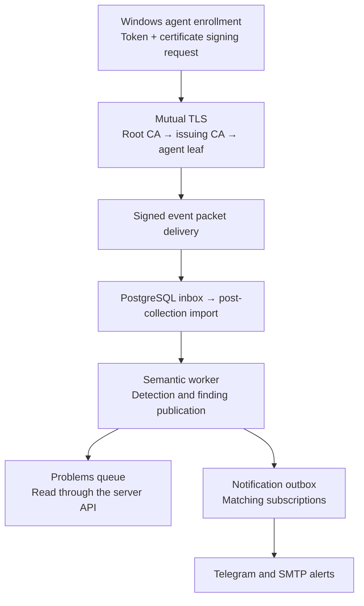

# SLI architecture

[Русский](ARCHITECTURE.ru.md)

SLI collects Active Directory snapshots and domain controller events, evaluates
security detections, and presents findings on the home page and in the problems
queue. Administrators can subscribe to alerts. The beta server runs on Debian 13.

## Where to make changes

| Area | Start here |
| --- | --- |
| Windows agent | [agent-dotnet/](../agent-dotnet/) contains the Windows service and collection modules. Start at the [service entry point](../agent-dotnet/src/Sli.Agent.Service/Program.cs), the [DC event collector](../agent-dotnet/src/Sli.Agent.Core/AdDcModule.cs), or the [AD snapshot module](../agent-dotnet/src/Sli.Agent.Windows/AdSnapshotModule.cs). |
| Server API and workers | [server-dotnet/](../server-dotnet/) contains the ASP.NET Core API and background commands. [Program.cs](../server-dotnet/src/Sli.Server/Program.cs) wires the endpoints and dispatches worker commands. |
| Web UI | [frontend/](../frontend/) contains the React app. Start at the [product router](../frontend/src/product-main.tsx), the shared [report renderer](../frontend/src/app/report-v2/ReportRenderer.tsx), or the [design system](../frontend/src/design-system/). The .NET server serves the built assets. |
| Storage and schema | PostgreSQL is the operational database and hot storage layer. The storage lifecycle code implements retention and the ClickHouse path for permanent history. See [storage lifecycle](../server-dotnet/src/Sli.Server/Storage/Lifecycle/) and [PostgreSQL migrations](../config/postgres_migrations/). |
| Debian installation | [deploy/linux/](../deploy/linux/) owns package hooks, setup, upgrade, recovery, and removal. [native_package.py](../deploy/linux/native_package.py) defines the packaged commands and hooks. |
| Kit and CI | [build_beta_kit.py](../deploy/linux/build_beta_kit.py) assembles the Debian kit, including the built frontend, packages, and checksums. The [beta-kit workflow](../.github/workflows/beta-kit.yml) calls the reusable [build workflow](../.github/workflows/beta-kit-build.yml), which also calls the [Windows MSI workflow](../.github/workflows/agent-msi.yml). CI definitions are in [.github/workflows/](../.github/workflows/). |

## Data flow

1. [Enrollment](../agent-dotnet/src/Sli.Agent.Core/Enrollment.cs) sends a token
   and a certificate signing request. The [server enrollment service](../server-dotnet/src/Sli.Server/Agents/Registry/AgentEnrollmentService.cs)
   validates the request and issues the agent certificate through the
   [issuing CA](../server-dotnet/src/Sli.Server/Agents/Certificates/AgentCertificateAuthority.cs).
2. [Packet delivery](../agent-dotnet/src/Sli.Agent.Core/PacketDelivery.cs) sends
   signed packets. The [packet endpoint](../server-dotnet/src/Sli.Server/Agents/AgentPacketEndpoints.cs)
   requires an agent client certificate. The [ingress service](../server-dotnet/src/Sli.Server/Agents/Ingress/AgentPacketService.cs)
   verifies signatures, records receipts, and recognizes duplicate deliveries.
   The [post-collection worker](../server-dotnet/src/Sli.Server/Agents/Consumer/PostCollectionRuntime.cs)
   imports queued data.
3. The [semantic worker](../server-dotnet/src/Sli.Server/Semantic/SemanticProduction.cs)
   runs detectors and evaluates the resulting signals. The
   [problems report reader](../server-dotnet/src/Sli.Server/Reporting/V2/SecurityProblemsReader.cs)
   reads the queue, and the [problems API](../server-dotnet/src/Sli.Server/Problems/ProblemEndpoints.cs)
   exposes findings and lifecycle actions. Finding publication can also enqueue
   notifications for matching subscriptions, independently of reads from the
   queue. See [notification enqueue SQL](../server-dotnet/src/Sli.Server/Semantic/SemanticRiskSql.cs)
   and [delivery workers](../server-dotnet/src/Sli.Server/Notifications/NotificationDeliveryHosting.cs).

## Native systemd services

[native_runtime.py](../deploy/linux/native_runtime.py) generates the application
units and selects the services started under `sli-dotnet.target`. PostgreSQL
is the managed database dependency in the beta unit set.

| Unit | Responsibility |
| --- | --- |
| `sli-dotnet-api.service` | Hosts the HTTPS API, agent endpoints, and web assets. |
| `sli-dotnet-post-collection.service` | Imports queued agent packets into operational storage. |
| `sli-dotnet-semantic.service` | Runs detection, risk evaluation, and finding publication. |
| `sli-dotnet-entity-state.service` | Processes jobs that project entity state. |
| `sli-dotnet-storage-lifecycle.service` | Runs storage retention and history lifecycle work. |
| `sli-dotnet-ad-snapshot-manifest-coordinator.service` | Coordinates publication of AD snapshot manifests. |
| `sli-dotnet-notification-delivery.service` | Delivers queued Telegram and SMTP notifications. |
| `sli-dotnet-notification-setup.service` | Handles notification configuration through a local socket. |
| `sli-dotnet-executor-light.service` | Runs core jobs assigned to the light profile, when enabled. |
| `sli-dotnet-executor-heavy.service` | Runs core jobs assigned to the heavy profile, when enabled. |
| `sli-dotnet-executor-long.service` | Runs core jobs assigned to the long profile, when enabled. |
| `sli-dotnet-what-where-when.service` | Builds the what/where/when projection. Excluded from the beta. |
| `sli-dotnet-remote-access.service` | Processes RADIUS session observations. Excluded from the beta. |
| `sli-dotnet-report-producer.service` | Produces scheduled reports. Excluded from the beta. |

The supporting units are generated by [native_host.py](../deploy/linux/native_host.py),
[native_runtime.py](../deploy/linux/native_runtime.py), and
[native_backup.py](../deploy/linux/native_backup.py).

| Unit | Responsibility |
| --- | --- |
| `sli-postgresql.service` | Runs the managed PostgreSQL cluster. |
| `sli-bootstrap-pg.service` | Creates the initial PostgreSQL identities and database. |
| `sli-ready.service` | Checks the accepted release and live migration ledger before starting application units. |
| `sli-health.service` | Rechecks readiness and worker health on `sli-health.timer`. |
| `sli-backup.service` | Captures recovery sets on `sli-backup.timer`. |
| `sli-backup-drill.service` | Tests a recovery set through an isolated restore. |

## PostgreSQL roles and migrations

The general application login is `adlog_user`. Ownership is separated from
runtime access. The migration executor checks membership in
`adlog_storage_owner` and runs migration DDL under that role. Workers such as
semantic processing and notification delivery use separate `NOINHERIT`
logins and explicitly assume bounded roles. For example, `sli_semantic_login`
assumes `adlog_semantic_worker`. Job executors use dedicated login roles for
each configured profile. See
[worker login provisioning](../deploy/linux/migrate.py),
[runtime grants](../deploy/linux/runtime_grants.sql), and the
[native migration executor](../deploy/linux/native_pg_migrate.py).

Numbered SQL and matching rollback files live in
[config/postgres_migrations/](../config/postgres_migrations/). The
[source ledger manifest](../deploy/linux/native_pg_ledger.json) pins file
checksums. PostgreSQL records applied versions, names, and checksums in
`public.schema_migrations`. The [inventory verifier](../deploy/linux/native_pg_inventory.py)
checks the source manifest and compares ledger readback against the expected
migrations. See [migration rules](../CONTRIBUTING.md#postgresql-migrations).

## Install, upgrade, and recovery

| Operation | Entry point and behavior |
| --- | --- |
| Install | [install-beta-kit](../deploy/linux/install-beta-kit) verifies kit checksums, installs Debian packages with APT, and invokes `sli-setup`. [native_setup.py](../deploy/linux/native_setup.py) orchestrates setup. [native_install.py](../deploy/linux/native_install.py) configures the database and services and accepts the release after readiness checks. |
| Upgrade | Debian package hooks call [native_upgrade.py](../deploy/linux/native_upgrade.py). It fences writers, verifies a recovery checkpoint, applies pending migrations, checks candidate readiness, and commits the release. |
| Rollback | Failed activation uses the upgrade coordinator's recovery path. The explicit `sli-rollback` command uses [native_restore.py](../deploy/linux/native_restore.py) to save the current state, restore the pre-update checkpoint, and reconcile the previous Debian packages. |
| Backup and restore | [native_backup.py](../deploy/linux/native_backup.py) captures PostgreSQL and required installation state into recovery sets. It provides capture and drill commands and dispatches `sli-restore` to [native_restore.py](../deploy/linux/native_restore.py). |
| Removal | `sli-remove` runs [native_remove.py](../deploy/linux/native_remove.py). Normal removal retains data. The explicit `--purge-data` mode also removes SLI data and configuration. |

The installed-release receipt is in `/var/lib/sli/state`. Upgrade journals live
under `/var/lib/sli/transactions`, and `/opt/sli/current` points to the selected
versioned release. The database volume is mounted at `/srv/sli-db`, with the
PostgreSQL cluster at `/srv/sli-db/pgdata/18/main`. Native backups are under
`/var/backups/sli/native`. See the [server installation guide](install/SERVER_INSTALL.en.md)
for operator steps.

## Frozen Python server

[server/](../server/) is a frozen reference. Make product server changes in
[server-dotnet/](../server-dotnet/). Linux installer helpers still import some
of its modules. For example, [sli_secrets.py](../deploy/linux/sli_secrets.py)
uses certificate and credential helpers,
[migrate.py](../deploy/linux/migrate.py) uses the credential-file reader, and
[installed_state.py](../deploy/linux/installed_state.py) uses release package
helpers. Preserve those imports when changing the packaging.

## Tests and CI

| Tests | CI workflow and job |
| --- | --- |
| [.NET server tests](../server-dotnet/tests/Sli.Server.Tests/) | [server-dotnet.yml](../.github/workflows/server-dotnet.yml) runs `server-tests` shards and `source-vectors`. The `build-and-test` job aggregates their results. |
| [Windows agent tests](../agent-dotnet/tests/Sli.Agent.Tests/) | [agent-dotnet.yml](../.github/workflows/agent-dotnet.yml) runs the portable suite in `portable`. [agent-msi.yml](../.github/workflows/agent-msi.yml) validates the MSI in `msi` and runs installation lifecycle tests when elevated access is available. |
| [Vitest tests alongside frontend code](../frontend/src/) | [pr-gate.yml](../.github/workflows/pr-gate.yml) runs frontend checks and Vitest in `frontend`. |
| [Browser geometry tests](../frontend/tests/geometry/) | [ui-standard.yml](../.github/workflows/ui-standard.yml) runs `geometry` for affected PRs. |
| [Installer and Python tests](../tests/unit/) and [migration tests](../tests/migrations/) | [pr-gate.yml](../.github/workflows/pr-gate.yml) uses `source` for targeted checks, `tests` for Python suites, and `postgres` for database checks when selected. [beta-kit-build.yml](../.github/workflows/beta-kit-build.yml) runs kit tests in `build`. |
