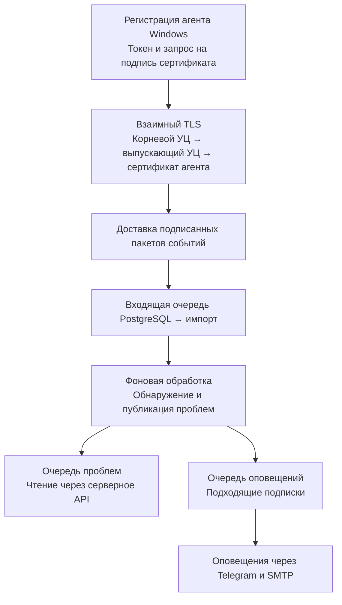

# Архитектура SLI

[English](ARCHITECTURE.md)

SLI собирает снимки Active Directory и события контроллеров домена, выявляет
признаки атак и показывает найденные проблемы на главной странице и в очереди
проблем. Администраторы могут подписаться на оповещения. Сервер бета-версии
работает на Debian 13.

## Где вносить изменения

| Область | С чего начать |
| --- | --- |
| Агент Windows | В [agent-dotnet/](../agent-dotnet/) находятся служба Windows и модули сбора. Начните с [точки входа службы](../agent-dotnet/src/Sli.Agent.Service/Program.cs), [сборщика событий контроллера домена](../agent-dotnet/src/Sli.Agent.Core/AdDcModule.cs) или [модуля снимков AD](../agent-dotnet/src/Sli.Agent.Windows/AdSnapshotModule.cs). |
| Серверное API и фоновые процессы | В [server-dotnet/](../server-dotnet/) находятся API на ASP.NET Core и фоновые команды. [Program.cs](../server-dotnet/src/Sli.Server/Program.cs) подключает обработчики API и запускает фоновые команды. |
| Веб-интерфейс | В [frontend/](../frontend/) находится приложение React. Начните с [маршрутов приложения](../frontend/src/product-main.tsx), общего [компонента отображения отчётов](../frontend/src/app/report-v2/ReportRenderer.tsx) или [дизайн-системы](../frontend/src/design-system/). Собранные ресурсы отдаёт сервер .NET. |
| Хранилище и схема | PostgreSQL служит операционной базой и горячим слоем хранения. Код жизненного цикла хранилища реализует политику хранения и работу с постоянной историей в ClickHouse. См. [жизненный цикл хранилища](../server-dotnet/src/Sli.Server/Storage/Lifecycle/) и [миграции PostgreSQL](../config/postgres_migrations/). |
| Установка на Debian | В [deploy/linux/](../deploy/linux/) находятся сценарии пакетов, первоначальная настройка, обновление, восстановление и удаление. [native_package.py](../deploy/linux/native_package.py) определяет команды и сценарии, входящие в пакеты. |
| Комплект и CI | [build_beta_kit.py](../deploy/linux/build_beta_kit.py) собирает комплект для Debian, включая собранный интерфейс, пакеты и контрольные суммы. [Процесс beta-kit](../.github/workflows/beta-kit.yml) вызывает переиспользуемый [процесс сборки](../.github/workflows/beta-kit-build.yml), который также вызывает [сборку MSI для Windows](../.github/workflows/agent-msi.yml). Конфигурация CI находится в [.github/workflows/](../.github/workflows/). |

## Поток данных

1. При [регистрации](../agent-dotnet/src/Sli.Agent.Core/Enrollment.cs) агент
   отправляет токен и запрос на подпись сертификата.
   [Служба регистрации на сервере](../server-dotnet/src/Sli.Server/Agents/Registry/AgentEnrollmentService.cs)
   проверяет запрос и выдаёт сертификат агента через
   [выпускающий удостоверяющий центр](../server-dotnet/src/Sli.Server/Agents/Certificates/AgentCertificateAuthority.cs).
2. [Модуль доставки](../agent-dotnet/src/Sli.Agent.Core/PacketDelivery.cs)
   отправляет подписанные пакеты.
   [Обработчик приёма пакетов](../server-dotnet/src/Sli.Server/Agents/AgentPacketEndpoints.cs)
   требует клиентский сертификат агента.
   [Служба приёма](../server-dotnet/src/Sli.Server/Agents/Ingress/AgentPacketService.cs)
   проверяет подпись, сохраняет подтверждения приёма и распознаёт повторы.
   [Фоновый процесс импорта](../server-dotnet/src/Sli.Server/Agents/Consumer/PostCollectionRuntime.cs)
   импортирует данные из очереди.
3. [Процесс семантической обработки](../server-dotnet/src/Sli.Server/Semantic/SemanticProduction.cs)
   запускает детекторы и оценивает полученные сигналы.
   [Модуль отчёта о проблемах](../server-dotnet/src/Sli.Server/Reporting/V2/SecurityProblemsReader.cs)
   читает очередь, а [API проблем](../server-dotnet/src/Sli.Server/Problems/ProblemEndpoints.cs)
   отдаёт найденные проблемы и обрабатывает операции их жизненного цикла.
   Публикация проблемы также может поставить оповещения в очередь по
   подходящим подпискам независимо от чтения очереди проблем.
   См. [SQL постановки оповещений в очередь](../server-dotnet/src/Sli.Server/Semantic/SemanticRiskSql.cs)
   и [процессы доставки](../server-dotnet/src/Sli.Server/Notifications/NotificationDeliveryHosting.cs).

## Службы systemd

[native_runtime.py](../deploy/linux/native_runtime.py) формирует юниты и
выбирает службы, запускаемые через `sli-dotnet.target`. PostgreSQL — управляемая
база данных, от которой зависят службы бета-версии.

| Юнит | Назначение |
| --- | --- |
| `sli-dotnet-api.service` | Обслуживает HTTPS API, запросы агентов и ресурсы веб-интерфейса. |
| `sli-dotnet-post-collection.service` | Импортирует пакеты агентов из очереди в операционное хранилище. |
| `sli-dotnet-semantic.service` | Запускает обнаружение, оценку риска и публикацию проблем. |
| `sli-dotnet-entity-state.service` | Выполняет задания по построению состояния объектов. |
| `sli-dotnet-storage-lifecycle.service` | Выполняет операции хранения, очистки и обслуживания истории. |
| `sli-dotnet-ad-snapshot-manifest-coordinator.service` | Координирует публикацию манифестов снимков AD. |
| `sli-dotnet-notification-delivery.service` | Доставляет оповещения из очереди через Telegram и SMTP. |
| `sli-dotnet-notification-setup.service` | Обрабатывает настройку оповещений через локальный сокет. |
| `sli-dotnet-executor-light.service` | Выполняет задания ядра профиля light, если он включён. |
| `sli-dotnet-executor-heavy.service` | Выполняет задания ядра профиля heavy, если он включён. |
| `sli-dotnet-executor-long.service` | Выполняет задания ядра профиля long, если он включён. |
| `sli-dotnet-what-where-when.service` | Строит представление «что, где, когда». Исключена из бета-версии. |
| `sli-dotnet-remote-access.service` | Обрабатывает наблюдения о сеансах RADIUS. Исключена из бета-версии. |
| `sli-dotnet-report-producer.service` | Формирует отчёты по расписанию. Исключена из бета-версии. |

Вспомогательные юниты формируют [native_host.py](../deploy/linux/native_host.py),
[native_runtime.py](../deploy/linux/native_runtime.py) и
[native_backup.py](../deploy/linux/native_backup.py).

| Юнит | Назначение |
| --- | --- |
| `sli-postgresql.service` | Запускает управляемый кластер PostgreSQL. |
| `sli-bootstrap-pg.service` | Создаёт начальные учётные записи и базу PostgreSQL. |
| `sli-ready.service` | Проверяет принятую версию и журнал миграций в базе перед запуском приложения. |
| `sli-health.service` | Повторно проверяет готовность и состояние фоновых служб по `sli-health.timer`. |
| `sli-backup.service` | Создаёт комплекты для восстановления по `sli-backup.timer`. |
| `sli-backup-drill.service` | Проверяет комплект в изолированном восстановлении. |

## Роли и миграции PostgreSQL

Основная учётная запись приложения — `adlog_user`. Права владельца отделены
от прав приложения. Исполнитель миграций проверяет членство в
`adlog_storage_owner` и выполняет DDL миграций от этой роли. Процессы
семантической обработки и доставки оповещений подключаются под отдельными
учётными записями с `NOINHERIT` и явно переключаются на роли с ограниченными
правами. Например, `sli_semantic_login` переключается на роль
`adlog_semantic_worker`. Исполнители заданий используют выделенные роли
с правом входа для каждого настроенного профиля.
См. [создание учётных записей](../deploy/linux/migrate.py),
[права приложения](../deploy/linux/runtime_grants.sql) и
[исполнитель миграций](../deploy/linux/native_pg_migrate.py).

Нумерованные SQL-миграции и соответствующие файлы отката находятся в
[config/postgres_migrations/](../config/postgres_migrations/).
[Манифест в репозитории](../deploy/linux/native_pg_ledger.json) фиксирует
контрольные суммы файлов. PostgreSQL записывает версии, имена и контрольные
суммы применённых миграций в `public.schema_migrations`.
[Проверка миграций](../deploy/linux/native_pg_inventory.py) сверяет манифест
с исходными файлами, а прочитанный журнал — с ожидаемым набором миграций.
См. [правила миграций](../CONTRIBUTING.md#postgresql-migrations).

## Установка, обновление и восстановление

| Операция | Точка входа и поведение |
| --- | --- |
| Установка | [install-beta-kit](../deploy/linux/install-beta-kit) сверяет контрольные суммы комплекта, устанавливает пакеты Debian через APT и вызывает `sli-setup`. [native_setup.py](../deploy/linux/native_setup.py) управляет настройкой. [native_install.py](../deploy/linux/native_install.py) настраивает базу и службы и принимает версию после проверки готовности. |
| Обновление | Сценарии пакетов Debian вызывают [native_upgrade.py](../deploy/linux/native_upgrade.py). Он останавливает пишущие процессы, проверяет точку восстановления, применяет ожидающие миграции, проверяет готовность новой версии и принимает её. |
| Откат | При сбое активации координатор обновления запускает восстановление. Явная команда `sli-rollback` использует [native_restore.py](../deploy/linux/native_restore.py), чтобы сохранить текущее состояние, восстановить копию до обновления и вернуть прежние пакеты Debian. |
| Резервное копирование и восстановление | [native_backup.py](../deploy/linux/native_backup.py) сохраняет PostgreSQL и необходимое состояние установки в комплекты восстановления. Он поддерживает создание и проверочное восстановление комплектов и передаёт вызов `sli-restore` в [native_restore.py](../deploy/linux/native_restore.py). |
| Удаление | `sli-remove` запускает [native_remove.py](../deploy/linux/native_remove.py). Обычное удаление сохраняет данные. Явный режим `--purge-data` удаляет также данные и настройки SLI. |

Запись об установленной версии находится в `/var/lib/sli/state`. Журналы
операций обновления хранятся в `/var/lib/sli/transactions`, а
`/opt/sli/current` указывает на выбранную версию. Том базы смонтирован в
`/srv/sli-db`, каталог кластера PostgreSQL — `/srv/sli-db/pgdata/18/main`.
Резервные копии хранятся в `/var/backups/sli/native`. Порядок действий
администратора описан в [руководстве по установке сервера](install/SERVER_INSTALL.ru.md).

## Замороженный сервер на Python

[server/](../server/) заморожен и служит справочником. Вносите изменения
серверной части продукта в [server-dotnet/](../server-dotnet/).
Вспомогательные модули установщика Linux всё ещё импортируют часть кода
Python. Например, [sli_secrets.py](../deploy/linux/sli_secrets.py) использует
вспомогательные функции работы с сертификатами и учётными данными,
[migrate.py](../deploy/linux/migrate.py) читает файлы учётных данных, а
[installed_state.py](../deploy/linux/installed_state.py) использует функции
работы с пакетами выпуска. При изменении упаковки сохраняйте эти импорты.

## Тесты и CI

| Тесты | Процесс CI и задание |
| --- | --- |
| [Тесты сервера .NET](../server-dotnet/tests/Sli.Server.Tests/) | [server-dotnet.yml](../.github/workflows/server-dotnet.yml) параллельно запускает группы `server-tests` и отдельно выполняет `source-vectors`. Задание `build-and-test` проверяет их результаты. |
| [Тесты агента Windows](../agent-dotnet/tests/Sli.Agent.Tests/) | [agent-dotnet.yml](../.github/workflows/agent-dotnet.yml) запускает переносимый набор тестов в `portable`. [agent-msi.yml](../.github/workflows/agent-msi.yml) проверяет MSI в `msi` и тестирует жизненный цикл установки при наличии повышенных прав. |
| [Тесты Vitest рядом с кодом интерфейса](../frontend/src/) | [pr-gate.yml](../.github/workflows/pr-gate.yml) выполняет проверки интерфейса и Vitest в `frontend`. |
| [Браузерные тесты геометрии](../frontend/tests/geometry/) | [ui-standard.yml](../.github/workflows/ui-standard.yml) запускает `geometry` для затрагивающих интерфейс PR. |
| [Тесты установщика и Python](../tests/unit/) и [тесты миграций](../tests/migrations/) | [pr-gate.yml](../.github/workflows/pr-gate.yml) выполняет целевые проверки в `source`, тесты Python в `tests` и проверки базы в `postgres`, когда они входят в объём проверки. [beta-kit-build.yml](../.github/workflows/beta-kit-build.yml) выполняет тесты комплекта в `build`. |
