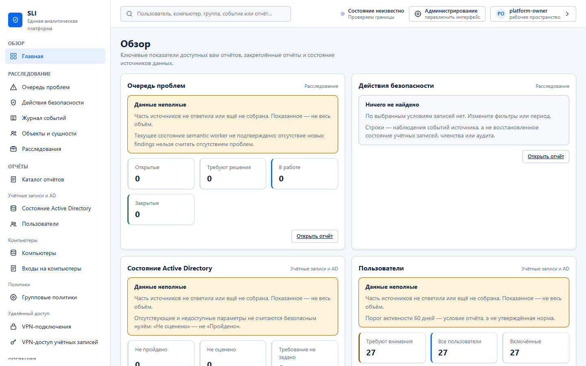
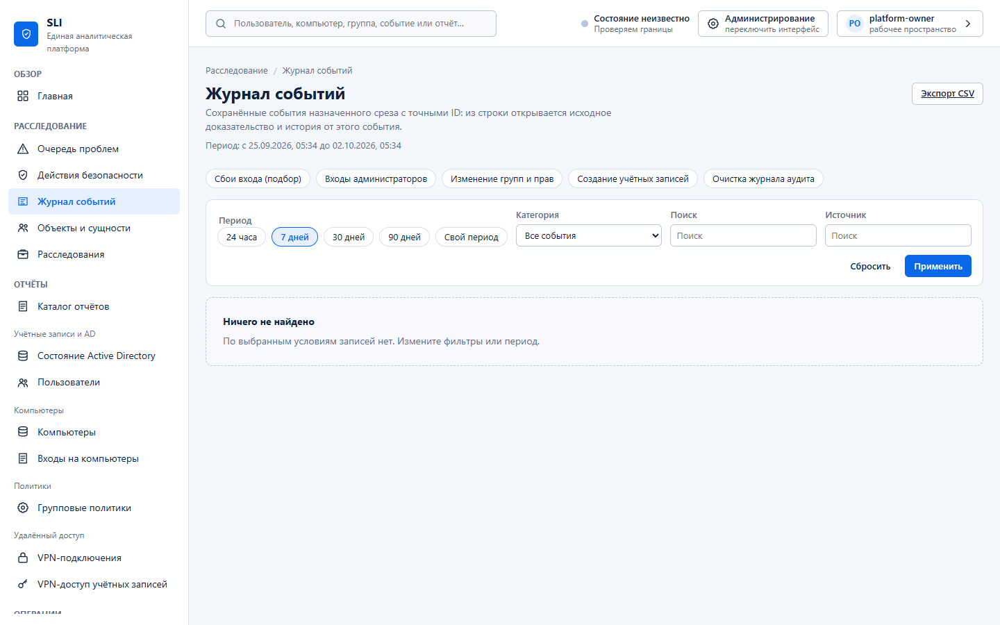
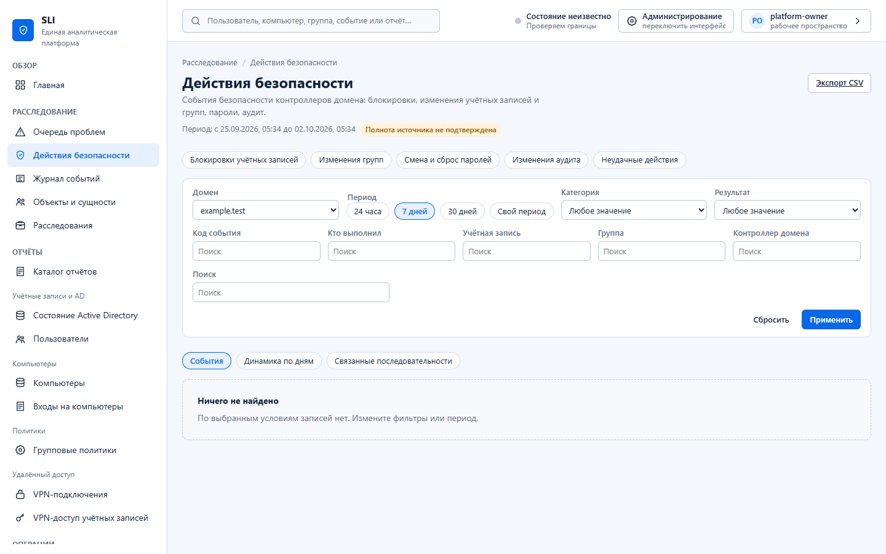
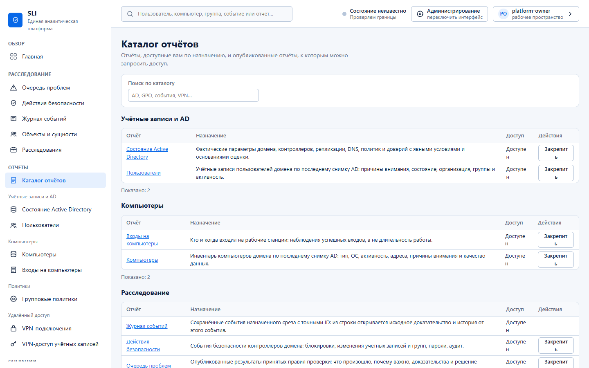
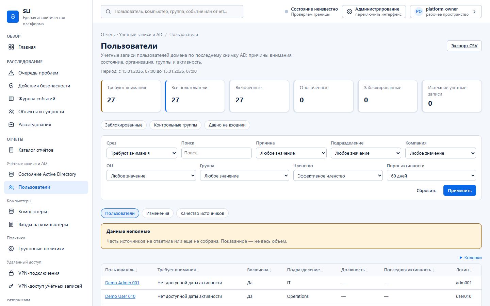
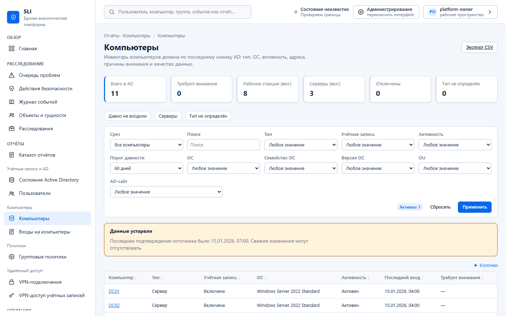

# Руководство пользователя SLI Platform

> Для нативной беты Debian см. [рабочие экраны](ru/user-guide.md),
> [каталог обнаружений](ru/detections.md) и их [английскую версию](en/user-guide.md).

Документ для аналитиков безопасности и ИТ-специалистов, которые работают в
веб-интерфейсе (адрес вида `https://<сервер>/app`). Администрирование описано в
[руководстве администратора](ru/administration.md). Примеры имён в документе вымышленные: домен
`example.test`, адреса RFC 5737.

Скриншоты сняты на синтетических демо-данных (`scripts/demo/`).

## 1. Вход и общий вид

Если на сервере включена авторизация, веб открывает страницу входа. Войдите
локальной учётной записью, которую создал администратор. Галочка «Запомнить
меня» продлевает сессию до 14 дней, иначе она действует 12 часов. Выйти можно
из меню профиля в правом верхнем углу; там же страница «Профиль и отображение».
В меню профиля переключаются тема (как в системе, светлая, тёмная) и язык
интерфейса (русский, English); выбор запоминается в браузере. English
частичный: переведены оболочка и общие состояния, страницы переводятся
постепенно.

Окно состоит из трёх частей:

- **левое меню** — разделы платформы (показаны только доступные вам);
- **верхняя панель** — глобальный поиск, индикатор свежести данных, кнопка
  значок шестерёнки «Администрирование» (если у вас есть
  административные разделы; он открывает зону администрирования с отдельным
  меню и ссылкой «← К работе») и профиль;
- **рабочая область** страницы.

Меню не определяет права: если раздела нет, значит, доступа к нему у вас нет;
сервер проверяет права на каждый запрос. Нужный отчёт можно запросить в
«Каталоге отчётов».

Индикатор свежести показывает актуальность данных: «Есть задержка»,
«Частичный сбор», «Сбор нарушен». Увидев последнее, сообщите администратору.

## 2. Разделы интерфейса

Меню делится на пять разделов. Названия взяты из интерфейса.

**Обзор**
- «Главная» (`/app`, заголовок «Обзор») — ключевые показатели доступных
  отчётов, закреплённые отчёты и состояние источников.

**Расследование**
- «Очередь проблем» — проблемы безопасности, ожидающие разбора;
- «Действия безопасности» — цепочки событий безопасности (раздел 5);
- «Журнал событий» — поиск и просмотр событий (раздел 3);
- «Объекты и сущности» — учётные записи, компьютеры и другие объекты (раздел 9);
- «Расследования» — дела (раздел 6).

**Отчёты**
- отдельного пункта «Каталог отчётов» в меню нет; каталог (`/app/reports`) открывается ссылками «Открыть отчёт» и по прямому адресу;
- «Учётные записи и AD»: «Состояние Active Directory», «Пользователи»;
- «Компьютеры»: «Компьютеры», «Входы на компьютеры»;
- «Политики»: «Групповые политики»;
- «Удалённый доступ»: «VPN-подключения», «VPN-доступ учётных записей».

Раздел **Администрирование** доступен в пределах ваших прав. Страницы и пути
описаны в [руководстве администратора](ru/administration.md).

## 3. Поиск событий

Глобальный поиск в верхней панели принимает пользователя, компьютер, группу,
событие или отчёт: по Enter открывается страница «Объекты и сущности» с
результатами. Сами события смотрите в «Журнале событий» (отчёт
`events.journal`); откройте строку события, чтобы перейти в его карточку.

## 4. Карточка события и связи

Карточка события (`/app/events/<идентификатор>`) имеет две вкладки:

- «Обзор» — нормализованные поля, связанный контекст (связанные события и
  факты), доказательства и связанные сущности. Показан срез, ограниченный вашими
  правами: отсутствие связи не доказывает, что её нет;
- «Исходные данные» — сообщение Windows и поля EventData.

Из карточки можно перейти к связанным сущностям и событиям.

## 5. Монитор событий безопасности

Раздел «Действия безопасности» (отчёт `security.events.chains`) показывает
действия безопасности как цепочки событий, а не россыпь отдельных строк.
Откройте цепочку, чтобы увидеть входящие в неё события, и перейдите к
доказательствам в карточке события. «Очередь проблем» собирает проблемы
безопасности со статусами («Новое», «Открыто», «Повторяется», «В работе», «На
проверке», «Решено», «Закрыто», «Исключено»). Выгрузка доступна там, где у
отчёта есть кнопка экспорта.

## 6. Расследования и дела

«Расследования» (`/app/investigations`) — рабочее место: откройте событие или
объект по точному идентификатору, задайте период, и страница построит историю
по доступным данным. К расследованию показываются связанные находки. Отдельное
дело открывается на странице `/app/investigations/<идентификатор>`; у дел
те же статусы. «Семантические сценарии» (`/app/scenarios`) — итоговые цепочки
поверх нормализованных фактов; идентификатор события остаётся доказательством,
а не выводом.

## 7. Находки

Находки (findings) — выводы платформы со статусом; обновлять статус могут
пользователи с ролью «ИТ» и выше. Находки видны на вкладке «Находки» карточки
сущности и среди связанных находок расследования.

## 8. Отчёты

Каталог отчётов (`/app/reports`; в меню не показывается) показывает отчёты, доступные вам по
назначению, и опубликованные отчёты. Если нужного нет, запросите доступ в его
карточке — заявку рассматривает администратор. Отчёт открывается по адресу
`/app/report/<ключ>`: фильтры, таблицы и, при наличии права, кнопка «Экспорт»
или «Экспорт CSV». Отчёты по AD, пользователям, компьютерам и политикам
строятся по домену, который задал администратор. У отдельных отчётов есть
печатная форма («Печать»).

## 9. Сущности: учётные записи и компьютеры

«Объекты и сущности» (`/app/objects`) — поиск по учётным записям, компьютерам,
группам, IP-адресам и другим объектам; экран только читает данные. Карточка
сущности (`/app/entities/<идентификатор>`) содержит вкладки (набор зависит от
типа и ваших прав): «Обзор», «Членство в группах», «Доступ и привилегии»,
«Состояния», «Находки», «События», «Действия безопасности», «VPN-сессии»,
«Технические атрибуты». Ссылка «Назад» возвращает туда, откуда вы пришли.

## 10. Экспорт

Экспорт доступен не везде, а только там, где у отчёта разрешена выгрузка и у
вас есть право: на странице отчёта — «Экспорт» или «Экспорт CSV»; на странице
«Сбор и хранилище» (администраторам) — «Экспорт состояния»; в печатных
формах — «Печать». Если кнопки нет, права на выгрузку у вас нет — обратитесь к
администратору.
